# Database

PostgreSQL, accessed through Prisma. The schema lives in
`server/prisma/schema.prisma` and migrations in `server/prisma/migrations`.

## Entity relationships

```mermaid
erDiagram
    User ||--o| Profile : "has one"
    User ||--o| UserPreference : "has one"
    User ||--o{ AuthSession : "refresh sessions"
    User ||--o{ AuthToken : "verify / reset tokens"
    User ||--o{ UserSkill : "lists skills"
    User ||--o{ Availability : "declares slots"
    User ||--o{ Notification : "receives"
    User ||--o{ Follow : "follows"
    User ||--o{ UserBlock : "blocks"
    User ||--o{ Report : "files / is target of"
    User ||--o{ Review : "writes / receives"
    User ||--o{ Message : "sends"
    User ||--o{ ConversationParticipant : "joins"
    User ||--o{ CommunityPost : "authors"
    User ||--o{ CommunityComment : "authors"
    User ||--o{ AuditLog : "acts in"

    SkillCategory ||--o{ Skill : "groups"
    Skill ||--o{ UserSkill : "listed as"
    Skill ||--o{ CommunityPost : "tags"

    ExchangeRequest }o--|| User : "initiator"
    ExchangeRequest }o--|| User : "recipient"
    ExchangeRequest }o--o| Skill : "offered skill"
    ExchangeRequest }o--o| Skill : "requested skill"
    ExchangeRequest }o--o| ExchangeRequest : "counter of"
    ExchangeRequest }o--o| Exchange : "becomes"

    Exchange ||--o{ ExchangeParticipant : "has two"
    Exchange ||--o{ Milestone : "tracks"
    Exchange ||--o{ Session : "schedules"
    Exchange ||--o{ ExchangeNote : "holds notes"
    Exchange ||--o{ ExchangeEvent : "audit timeline"
    Exchange ||--o{ Review : "produces"

    Conversation ||--o{ ConversationParticipant : "members"
    Conversation ||--o{ Message : "contains"

    CommunityPost ||--o{ CommunityComment : "has"
    CommunityPost ||--o{ CommunityPostVote : "voted on"
    CommunityComment ||--o{ CommunityCommentVote : "voted on"
    CommunityComment ||--o{ CommunityComment : "replies"

    SupportTicket }o--o| User : "raised by"
```



## Core entities

### Identity

| Model | Notes |
| --- | --- |
| `User` | Email is stored lowercased and unique; username is unique. Carries the role. |
| `Profile` | Display name, bio, location, timezone, languages, learning goals, session format. |
| `UserPreference` | Notification and privacy switches. |
| `AuthSession` | One row per refresh token, so sessions can be listed and revoked. |
| `AuthToken` | Single-use, expiring tokens for email verification and password reset. |

### Skills

| Model | Notes |
| --- | --- |
| `SkillCategory` | Top-level taxonomy. `isActive` allows retiring a category without deleting history. |
| `Skill` | Belongs to a category; deletion is restricted while skills reference it. |
| `UserSkill` | Join table between user and skill, with a direction (`TEACH` / `LEARN`), level, description, outcomes and optional evidence link. Unique per user, skill and direction. |
| `Availability` | Declared weekly availability, used by matching and conflict checks. |

### Exchanges

| Model | Notes |
| --- | --- |
| `ExchangeRequest` | A proposal. Records both members, the offered and requested skill, and the proposed schedule. A counter-proposal is a new request pointing at its parent. |
| `Exchange` | An agreed exchange. Created on acceptance, so a request and an exchange are separate records. |
| `ExchangeParticipant` | One row per member, storing which skill they teach and which they learn. |
| `Milestone` | A learning milestone within an exchange, with a done flag and author. |
| `Session` | A scheduled meeting, with start time, duration, timezone and status. |
| `ExchangeNote` | Shared notes and resources. |
| `ExchangeEvent` | Append-only timeline of status changes, used by the workspace timeline. |

### Communication and community

| Model | Notes |
| --- | --- |
| `Conversation` | A direct conversation between two members. |
| `ConversationParticipant` | Membership, with read state. Every message request re-checks this table. |
| `Message` | Text and optional attachment reference. |
| `Notification` | Typed, with read state and optional link. |
| `CommunityPost` / `CommunityComment` | Discussion with threaded replies and optional skill or category tags. |
| `CommunityPostVote` / `CommunityCommentVote` | One vote per user per item, enforced by a unique constraint. |
| `Review` | One review per author per exchange, enforced by a unique constraint. Self-reviews are rejected in the service layer. |

### Trust and safety

| Model | Notes |
| --- | --- |
| `Report` | A moderation report against a user, post, comment or message, with a status. |
| `UserBlock` | One row per blocker and blocked pair; unique. |
| `AuditLog` | Records sensitive administrative actions. Actor is set to null if the account is deleted, so the record survives. |
| `SupportTicket` | Contact form submissions. |

## Integrity and indexing

- Foreign keys carry explicit `onDelete` behaviour. Cascades are used for
  dependent records such as sessions and notes. `SetNull` preserves history where
  the referenced row may be removed, as with an audit log actor or a report
  target.
- Unique constraints cover normalised email, username, user plus skill plus
  direction, votes, reviews, follows and blocks. These make duplicate rows
  impossible rather than merely discouraged.
- Indexes cover the columns used for filtering and pagination: skill and
  category lookups, exchange status, session start time, notification read state,
  and message creation time.
- Timestamps (`createdAt`, `updatedAt`) are present on all mutable entities.
- Multi-step writes, such as accepting a request and creating the exchange with
  its participants, run inside a transaction so a partial exchange cannot exist.

## Migrations

Migrations are versioned SQL files under `server/prisma/migrations` and are the
only supported way to change the schema. The second migration,
`integrity_constraints`, adds database-level checks and constraints that back up
the application logic.

```bash
cd server
npm run prisma:migrate      # create and apply a migration (development)
npm run prisma:deploy       # apply pending migrations (production)
npm run db:reset            # drop, reapply and reseed
```

## Seed data

`server/prisma/seed.ts` is idempotent: it removes its own demo accounts before
recreating them, so it can be run repeatedly. It creates the category and skill
taxonomy, sixteen accounts (an administrator, a moderator and fourteen members),
an active exchange with sessions and milestones, a completed exchange with
reviews, a second exchange, pending requests, community posts and notifications.
Every widget in the interface therefore has real data to display without anyone
having to click through the whole flow first.
